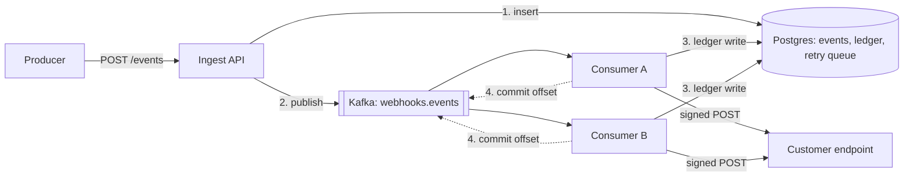

# I froze a Kafka consumer for 45 seconds. It came back and re-sent 137 webhooks.

A webhook platform makes a narrow promise. It doesn't promise that every event reaches the customer exactly once, because nobody can promise that about an HTTP server they don't control. What it promises is accountability: every accepted event is either delivered, waiting for a retry on a known schedule, or parked somewhere the customer can inspect and replay. Delivery is at-least-once, and every request carries an id so the receiver can drop duplicates. That contract allows a duplicate here and there. It doesn't allow a process that has lost track of what it owns and keeps sending anyway. A consumer that freezes and comes back is exactly that process, so I set out to break mine on purpose.

This is the write-up of that drill, from my project Reliant. One caveat up front: all of it ran on one laptop. The two consumers, the worker, Postgres, Redis and Redpanda (a Kafka-compatible broker) all shared one Windows machine through Docker Desktop. The numbers below show what happened in that setup, not how a cluster would behave.

## The setup

Reliant takes events from internal services and delivers each one as a signed HTTP POST to every customer endpoint subscribed to it. Two rules matter for this story.

**Postgres is the source of truth; Kafka is only the intake buffer.** Ingest writes the event to Postgres, then publishes it to Kafka, and answers 202 only after both have succeeded.

**The Kafka offset is committed only after the outcome is recorded.** The consumer reads a chunk of up to 200 messages and makes one delivery attempt per event and endpoint. It writes every outcome to a delivery ledger in Postgres, and only then commits the offset. If it crashes in between, Kafka redelivers the chunk. The customer may get a duplicate, but no delivery is ever missing from the ledger. I wrote that down as an architecture decision record (ADR-005), because the opposite order, committing first, is how an event silently disappears.



Failed attempts go to a retry queue in Postgres, which a separate delivery worker drains. That detail comes back later.

## The drill

The failure I wanted is number 6 in my spec: a consumer gets cut off from Kafka long enough for the group to hand its partitions to someone else, then comes back still holding work it had already started.

The drill is a script in the repo (`npm run loadtest -- consumer-freeze`). Here is what it does:

1. It starts two consumers and one delivery worker as Docker containers. The containers share Redpanda's network namespace, so they reach the broker at `localhost:9092`.
2. It creates 10 tenants, each with one endpoint that answers 200 at once.
3. It sends events at 50 per second.
4. After 15 seconds it freezes one consumer with `docker pause`, for 45 seconds. That's longer than the 30-second session timeout, so the broker decides the consumer is gone and moves its partitions to the other one.
5. It resumes the frozen consumer with `docker unpause`, keeps the load going for another 30 seconds, then waits for everything to drain.

`docker pause` stops every process in the container (it uses the cgroup freezer) without closing a single socket. The consumer's TCP connections stay open and its in-memory state is untouched. It just stops getting CPU time. That makes it a decent stand-in for a long GC pause or a VM that got descheduled.

The receiver counts how many times it sees each event id and when, so the script can tell three kinds of repeat apart: those during the freeze, those within 5 seconds of the resume, and those later. It also checks per-endpoint order against acceptance order, and compares the ledger with what was accepted.

## What went wrong

Nothing was lost and order held. But the customer got about 137 duplicate deliveries per run.

| | Run 1 | Run 2 |
|---|---|---|
| Accepted / delivered | 3,033 / 3,033 | 3,066 / 3,066 |
| Duplicate deliveries | 138 | 137: 136 within 5s of the resume, 1 during the freeze |
| Per-endpoint order inversions | 0 | 0 |
| Ledger | exact | exact |

Almost every duplicate arrived in the first seconds after the resume. The zombie was delivering events that the consumer that took over its partitions had already delivered.

Rebalancing did its job. While the consumer was frozen, the broker noticed the missing heartbeats, removed it from the group, and gave its partitions to the other consumer. That consumer started from the last committed offset and delivered everything again, correctly.

The trouble is that the frozen process didn't take part in any of this. When it woke up, it was in the middle of a JavaScript loop over a batch it had fetched before the freeze. From its point of view no time had passed. It still had the messages in memory and still believed it owned the partition, and the next line of code was "send the next POST".

Kafka does protect itself against zombies. Requests from a member of an old generation, like an offset commit or a heartbeat, are rejected. But that protection covers requests that reach the broker. An HTTP POST to a customer goes nowhere near Kafka. The broker can refuse the zombie's commit; it can't refuse the zombie's webhook.

So the real question was: when does the zombie find out? Here is what the inline delivery loop looked like before the fix:

```js
      const result = await context.with(traceCtx.get(event.event_id),
        () => sendSigned(event, endpoint, INLINE_TIMEOUT_MS));
      // ...metrics...
      ledger.push({ event_id: event.event_id, endpoint_id: endpoint.endpoint_id, tenant_id: event.tenant_id,
        attempt_number: 1, ...result, latencyMs: Date.now() - started });
      if (!outcomes.has(endpoint.endpoint_id)) outcomes.set(endpoint.endpoint_id, []);
      outcomes.get(endpoint.endpoint_id).push({ ok: result.ok, at: Date.now() });
      await heartbeat();
```

The consumer checked its membership with kafkajs's `heartbeat()`, but only *after* each attempt. And `heartbeat()` only contacts the broker once 3 seconds have passed since the last heartbeat. Otherwise it returns at once. Because the check came after the send, the zombie POSTed first and asked questions later. With endpoints answering in milliseconds, it worked through its in-memory batch for up to 3 seconds before a heartbeat actually reached the broker and failed.

The ledger stayed exact only because the heartbeat error was thrown inside the chunk, before the chunk's write step. That was luck in where the exception landed, not design.

## The fix

The fix moves the question in front of the side effect. Before every inline attempt, and again before the chunk writes anything, the consumer asks whether it is still a member of the group:

```js
let membershipLost = null, membershipCheck = null;
consumer.on(consumer.events.GROUP_JOIN, () => { membershipLost = null; });
async function stillMember(heartbeat) {
  if (membershipLost) throw membershipLost;
  membershipCheck ??= heartbeat().catch((err) => { membershipLost = err; })
    .finally(() => { membershipCheck = null; });
  await membershipCheck;
  if (membershipLost) throw membershipLost;
}
```

Three details matter here.

- **It asks the broker, not local state.** After a freeze longer than 3 seconds, which a zombie always has, `heartbeat()` really does go to the broker. The broker answers that this member isn't in the group any more, and the call throws.
- **The answer is process-wide.** Partitions are processed concurrently, so once one check learns that membership is lost, every partition's batch stops. Only a new `GROUP_JOIN` clears the flag.
- **Concurrent checks share one request.** The `??=` means many partitions asking at once wait on the same heartbeat instead of sending one each.

Then the guard goes in two places:

```js
      await stillMember(heartbeat);          // before every inline attempt
      const result = await context.with(traceCtx.get(event.event_id),
        () => sendSigned(event, endpoint, INLINE_TIMEOUT_MS));
  // ...after all attempts in the chunk:
  await stillMember(heartbeat);              // before any write
  await recordAttempts(ledger, links);
```

The first placement was obvious. I found the second only because the first fix's verification run failed in a new way.

In that run, the zombie's last remaining attempt was a request that was already in flight when I froze it. It timed out during the freeze. Because the chunk had no attempts left, there was no next check, so it finished normally. It then wrote a retry-queue row for the "failed" event, and the delivery worker delivered that event again. That was a third delivery: the original, the new owner's, and the worker's. The ledger showed 3,067 rows for 3,066 events.

The check before the writes closes that path. When the zombie stops, it skips the writes entirely, and nothing is lost by skipping them. The new owner reprocesses those messages from the last committed offset.

After the fix, three runs at the same settings:

| | Run 3 | Run 4 | Run 5 |
|---|---|---|---|
| Accepted / delivered | 3,060 / 3,060 | 3,046 / 3,046 | 3,023 / 3,023 |
| Duplicate deliveries | 0 | 0 | 1 (during the freeze) |
| Ledger rows / events | exact | exact | exact |

### Why the remaining duplicate is fine

Run 5 hit the edge case again. This time the zombie wrote nothing and no worker delivered the event a third time. The one duplicate left is the request that was in flight at the moment of the freeze.

That request reached the receiver just before the container stopped. The zombie never recorded the outcome, so the new owner saw an event with no record and delivered it. That is the correct behaviour. Nothing can know whether a request it was cut off in the middle of arrived, and refusing to retry it would risk losing the event, which is the one thing the contract forbids. Every request carries a `webhook-id` header, and receivers are told to drop ids they've already handled.

So the honest claim is not "zero duplicates". It's that a zombie now re-sends at most the requests that were in flight when it was cut off. At 50 events per second that was 0 or 1. At higher rates, with more partitions processed at once, it will be more: [TODO: measure].

## Trade-offs, and what I haven't built

The guard is check-then-act. If membership is lost between the check and the send, that one request still goes out. Nothing short of the receiver can close that window, because the side effect is an HTTP call to a server I don't control. What the check does is shrink the window from "up to 3 seconds of a batch" to the requests already on the wire. Within a chunk, different endpoints are attempted concurrently, so that's at most one request per endpoint being attempted at that moment.

The cost is low. When less than 3 seconds have passed, `heartbeat()` returns without a network call, so most checks cost nothing. I haven't measured how much throughput the checks cost: [TODO: measure].

There are also limits to what I tested. I only drilled a freeze. Two cases I haven't run:

- **A network partition**, where the process keeps running and keeps working through its 200-message chunk while it can't reach the broker.
- **A scale-out under load**, where the autoscaler adds a consumer and forces the same rebalance as part of normal operation.

These are the things I'd do differently or at higher scale. None of them are built for the consumer:

- **Fencing tokens on every side effect.** The usual answer to zombies is a token, such as the generation id, that every downstream write must carry, so a stale writer gets rejected. It works for my own database, and the delivery worker in the same repo now fences its writes to its retry-queue rows with a per-claim lease token. It can't work for a customer's HTTP endpoint, unless receivers agree to reject stale tokens, which is a much bigger ask than "dedupe on `webhook-id`".
- **Treating idempotent receivers as part of the product.** At-least-once only works if receivers actually dedupe. A real platform would ship verification and dedup helpers in its client libraries, and test that they're used, rather than just documenting the header.
- **A transactional outbox for the ingest side.** It doesn't fix zombies. But it removes the gap between "saved in Postgres" and "published to Kafka", which my system currently covers with a republisher process instead.

## Takeaways

- **Rebalancing protects the broker, not your side effects.** Kafka rejects a zombie's commits. It can't stop the zombie's HTTP calls, so the consumer has to ask before each one.
- **Put the check before the action and before the write.** Checking after the side effect means the zombie acts first and learns later. Fixing the first gap revealed a second one through the retry queue.
- **State the duplicate bound honestly.** After the fix, the bound is the requests in flight at the cut-off, not zero, and the receiver's dedup on `webhook-id` is what covers it.
